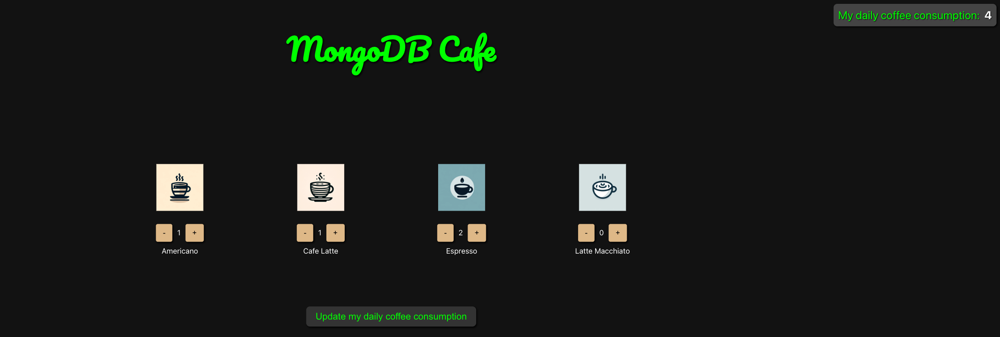

# Notice: Repository Deprecation
This repository is deprecated and no longer actively maintained. It contains outdated code examples or practices that do not align with current MongoDB best practices. While the repository remains accessible for reference purposes, we strongly discourage its use in production environments.
Users should be aware that this repository will not receive any further updates, bug fixes, or security patches. This code may expose you to security vulnerabilities, compatibility issues with current MongoDB versions, and potential performance problems. Any implementation based on this repository is at the user's own risk.
For up-to-date resources, please refer to the [MongoDB Developer Center](https://mongodb.com/developer).

# Description:
MongoCoffeeMenu is a web app built based on Atlas Device SDK for the Web(https://www.mongodb.com/docs/atlas/device-sdks/web/). 

The app works as a very simple coffee conusmption calculator that allows the user to select what coffee they had during the day and sync the total amount of coffee consumption with MongoDB Atlas. 

## Components:
1. Realm Web v2.0.0 [https://www.npmjs.com/package/realm-web]
2. MongoDB Atlas. *For this example app, I am using a M0 free tier cluster. To get a free cluster please visit https://www.mongodb.com/cloud/atlas/register.

## Useful commands:
1. npm install: After downloading the app please use this command in terminal to install the necessary dependencies.
2. npm start: Use this command to start the web app

